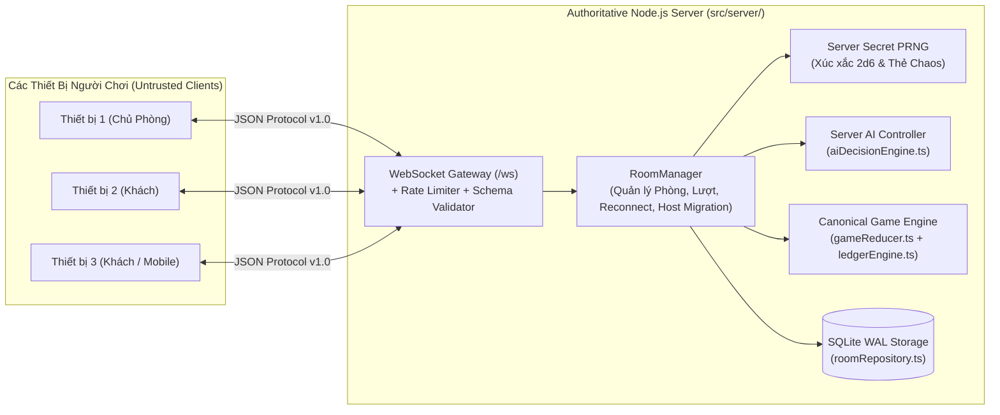

# CHAOS MONOPOLY — MULTIPLAYER ARCHITECTURE, PROTOCOL & DEPLOYMENT GUIDE (PHASE 04)

## 1. Tổng Quan Kiến Trúc (Architecture Overview)

Giai đoạn 04 chuyển đổi **CHAOS MONOPOLY** từ trò chơi chỉ chạy tại máy (Local Hot-Seat) thành nền tảng **Multiplayer Trực Tuyến Đa Thiết Bị (Server-Authoritative Online Platform)** trong khi vẫn bảo toàn 100% chế độ chơi tại máy và AI của các giai đoạn trước.



### Nguyên Tắc Thiết Kế Cốt Lõi:
1. **Một Nguồn Luật Chơi Duy Nhất (Single Canonical Engine):** Máy chủ (`src/server/roomManager.ts`) gọi trực tiếp `gameReducer.ts`, `ledgerEngine.ts`, `auctionEngine.ts`, `tradeEngine.ts`, `chaosEngine.ts` và `aiDecisionEngine.ts`. Không có bất kỳ bản sao logic luật chơi thứ hai nào ở phía backend.
2. **Máy Chủ Toàn Quyền Quyết Định (Server Authority):**
   - Client chỉ gửi **Ý định hành động (`ClientIntentPayload`)** như `{ type: 'ROLL_DICE' }`, `{ type: 'BUY_PROPERTY', tileId }`, `{ type: 'PLACE_AUCTION_BID', bidAmount }`.
   - Máy chủ kiểm tra tư cách thành viên phòng, lượt đi, pha hiện tại, chống trùng lặp `actionId`, tự sinh kết quả xúc xắc `2d6` và thẻ Chaos bằng `SeededPRNG` bí mật trên server, sau đó phát tán (`STATE_SYNC`) trạng thái đã kiểm chứng tới mọi thiết bị trong phòng.
3. **Ẩn Hạt Giống Ngẫu Nhiên (`config.seed`):** Hàm `sanitizeStateForClient` xóa `config.seed` trước khi gửi trạng thái về client để không ai có thể dự đoán trước kết quả xúc xắc hay thẻ Chaos.

---

## 2. Giao Thức WebSocket Phiên Bản 1.0 (`src/multiplayer/protocol.ts`)

Mọi gói tin đều có trường `"version": "1.0"` và giới hạn kích thước tối đa `16 KB` (`MAX_WS_MESSAGE_BYTES`).

### A. Thông Điệp Từ Client -> Server (`ClientToServerMessage`)
| Loại (`type`) | Mục Đích | Kiểm Tra Bảo Mật Trên Server |
| :--- | :--- | :--- |
| `CREATE_ROOM` | Tạo phòng riêng tư mới (2–4 chỗ) | Giới hạn tần suất theo IP, lọc XSS tên người chơi/tên phòng, sinh mã `CHAOS-XXXX` và `reconnectToken` 192-bit. |
| `JOIN_ROOM` | Tham gia phòng bằng mã `CHAOS-XXXX` | Kiểm tra phòng tồn tại, chưa hết hạn, chưa đầy, chưa bắt đầu và chống tham gia trùng phiên (`DUPLICATE_JOIN`). |
| `RECONNECT_ROOM` | Kết nối lại vị trí cũ sau khi rớt mạng / F5 | Xác thực `reconnectToken` bằng SHA-256 `crypto.timingSafeEqual`. |
| `SET_READY` | Đánh dấu Sẵn sàng / Hủy sẵn sàng | Chỉ thành viên trong phòng mới được cập nhật trạng thái của chính mình. |
| `SELECT_TOKEN` | Chọn nhân vật / quân cờ đại diện | Chỉ cho phép khi phòng đang ở trạng thái `WAITING` hoặc `READY`. |
| `CONFIGURE_ROOM` | Đổi vốn khởi điểm, giới hạn vòng, sức chứa | Chỉ Chủ phòng (`hostPlayerId`) mới có quyền gọi trước khi trận đấu bắt đầu. |
| `CONFIGURE_SEAT_AI` | Thêm/xóa hoặc đổi tính cách/độ khó AI | Chỉ Chủ phòng mới có quyền gọi; không cho phép ghi đè vị trí của người chơi thật. |
| `START_MATCH` | Bắt đầu trận đấu trực tuyến | Chỉ Chủ phòng mới có quyền gọi khi có từ 2 thành viên trở lên và tất cả đã `isReady`. |
| `SUBMIT_ACTION` | Gửi nước đi trong trận (`ClientIntentPayload`) | Kiểm tra thành viên phòng, lượt đi, pha, chống trùng `actionId`, chặn hoàn toàn các trường giả mạo (`dice`, `cash`, `ownerId`, `position`, `seed`). |

### B. Thông Điệp Từ Server -> Client (`ServerToClientMessage`)
- `WELCOME`: Cấp `sessionId` khi kết nối WebSocket thành công.
- `ROOM_JOINED`: Trả về thông tin phòng (`RoomPublicSummary`), `assignedPlayerId` (`player-1`..`player-4`), `reconnectToken` bí mật và `gameState` hiện tại.
- `ROOM_UPDATED`: Đồng bộ danh sách người chơi, trạng thái sẵn sàng và cấu hình phòng theo thời gian thực.
- `MATCH_STARTED`: Thông báo trận đấu bắt đầu kèm trạng thái bàn cờ khởi tạo (`stateVersion`).
- `STATE_SYNC`: Phát tán trạng thái bàn cờ chuẩn xác sau mỗi hành động của người chơi hoặc AI.
- `PLAYER_DISCONNECTED` / `PLAYER_RECONNECTED`: Thông báo khi có thành viên mất kết nối hoặc kết nối lại.
- `HOST_MIGRATED`: Thông báo khi quyền Chủ phòng được chuyển tự động sang người chơi khác.
- `ACTION_REJECTED` / `ERROR`: Trả về mã lỗi chuẩn (`ServerErrorCode`) và thông báo tiếng Việt rõ ràng.

---

## 3. Vòng Đời Phòng, Kết Nối Lại & Phục Hồi Sau Khởi Động Lại (`src/server/roomRepository.ts`)

1. **Các Trạng Thái Phòng (`RoomStatus`):**
   - `WAITING` -> `READY` -> `STARTING` -> `IN_GAME` -> `FINISHED` / `EXPIRED`.
2. **Chính Sách Khi Mất Kết Nối (`DisconnectPolicy`):**
   - Khi một người chơi rớt mạng hoặc tải lại trang (F5) trong lúc `IN_GAME`, vị trí của họ được giữ nguyên và máy chủ kích hoạt bộ đếm thời gian chờ kết nối lại (`reconnectGraceMs`, mặc định `60 giây`).
   - Nếu người chơi kết nối lại bằng `reconnectToken` hợp lệ, họ lấy lại toàn quyền điều khiển ngay lập tức.
   - Nếu quá thời gian chờ mà chưa kết nối lại, chính sách mặc định an toàn `AI_TAKEOVER` sẽ để AI Chiến Lược tạm thời đi thay để không làm treo ván đấu của những người chơi khác; ngay khi người chơi thật quay lại, quyền điều khiển được trả lại cho người chơi thật.
   - Nếu Chủ phòng mất kết nối, quyền Chủ phòng tự động chuyển (`HOST_MIGRATED`) sang người chơi đang kết nối tiếp theo.
3. **Lưu Trữ Bền Vững Bằng SQLite WAL (`node:sqlite`):**
   - Toàn bộ trạng thái phòng, trạng thái bàn cờ, băm SHA-256 của `reconnectToken`, trạng thái bộ sinh số ngẫu nhiên (`prngState`) và nhật ký kiểm toán hành động (`action_audit_log`) được ghi nguyên tử (Atomic Transaction) vào SQLite ở chế độ `WAL`.
   - Khi máy chủ khởi động lại, `RoomManager.recoverRoomsFromRepository()` tự động khôi phục mọi phòng đang hoạt động.

---

## 4. Hướng Dẫn Chạy Thử Nghiệm Đa Thiết Bị & Triển Khai (Deployment Guide)

### A. Chạy Máy Chủ Multiplayer & Giao Diện Trên Máy Cục Bộ / Mạng LAN
1. **Khởi động Máy chủ Authoritative WebSocket (Cổng mặc định `3001`):**
   ```bash
   npm run server
   ```
   - Kiểm tra sức khỏe máy chủ: `GET http://localhost:3001/api/health`
   - Kiểm tra trạng thái sẵn sàng: `GET http://localhost:3001/api/ready`
2. **Khởi động Giao diện Web (Cổng mặc định `3000`):**
   ```bash
   npm run dev
   ```
3. **Thử nghiệm nhiều người chơi trên nhiều trình duyệt / thiết bị:**
   - Mở Tab 1 tại `http://localhost:3000`, chọn tab **"Tạo Phòng Online"**, đặt tên và nhấn tạo phòng để nhận mã `CHAOS-XXXX`.
   - Mở Tab 2 (hoặc cửa sổ Ẩn danh / thiết bị khác cùng mạng LAN), chọn tab **"Vào Phòng Online"**, nhập mã `CHAOS-XXXX` để vào cùng phòng chờ theo thời gian thực.
   - Chủ phòng có thể thêm AI vào các ghế trống và nhấn **"Bắt Đầu Trận Đấu Online"**.
