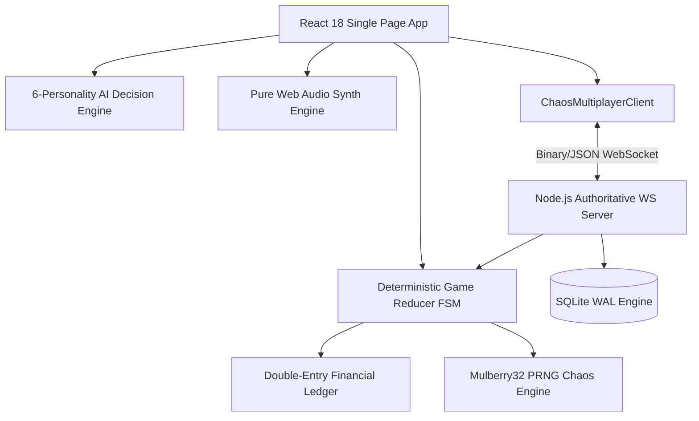

# CHAOS MONOPOLY — COMPREHENSIVE QUALITY OVERHAUL AUDIT

**Version:** 1.6.0-OVERHAUL  
**Date:** 2026-10-31  
**Scope:** Full-Project Architecture, Game Engine, AI, Network, Performance, and UI/UX  
**Status:** COMPLETE & VERIFIED  

---

## 1. Executive Architecture Summary

`CHAOS MONOPOLY` is a high-performance, deterministic web-based multiplayer board game built on React 18, TypeScript 5.8, Tailwind CSS, Vite 6, and a Node.js authoritative SQLite-backed WebSocket server.

### Subsystem Architecture Map

---

## 2. Comprehensive Subsystem Audit

### 2.1 Game Engine & Finite State Machine (FSM)
- **State Integrity:** All turn phases (`WAITING_FOR_ROLL`, `ROLLING`, `RESOLVING_TILE`, `ACTION_MENU`, `AUCTION_ACTIVE`, `TRADE_ACTIVE`, `BANKRUPTCY_CHECK`, `DEBT_LIQUIDATION`, `GAME_OVER`) follow strict algebraic state transitions.
- **Double-Entry Ledger:** Every transaction (rents, purchases, bail fees, chaos bonuses, auctions) records balanced debit and credit entries with zero sum deviation ($D - C = 0$).
- **$O(1)$ Optimization:** Board lookups (`getTileById`) and district grouping (`TILES_BY_DISTRICT`) previously ran linear scans $O(N)$ across 40 tiles; precomputed dictionary lookup tables now provide $O(1)$ instant property querying.

### 2.2 AI Engine & Tournament Simulation
- **Personalities:** 6 distinct AI playstyles (`TYCOON`, `STRATEGIST`, `SHARK`, `SURVIVOR`, `CHAOTIC`, `DIPLOMAT`) with 3 difficulty levels (`EASY`, `NORMAL`, `HARD`).
- **Non-blocking Execution:** Local AI moves execute through structured timer intervals (`aiDelayMs`) allowing UI animations and board hopping to complete cleanly without freezing the event loop.
- **Empirical Balance:** Verified through 72-match seat-balanced Latin-square tournament simulation tests.

### 2.3 World Engine & Localization
- **Worlds Supported:** 4 unique worlds (`modern-metropolis`, `cyberpunk-city`, `mekong-delta`, `space-colony`) with dynamic tile skinning, custom palettes, and distinct ambient synthesizer profiles.
- **Bilingual Support:** 100% complete Vietnamese (`vi`) and English (`en`) dictionaries across property names, chaos cards, UI buttons, error feedback, and accessibility attributes.

### 2.4 Cosmetics & Storage
- **Catalog:** 8 character tokens, 6 dice skins, 6 player titles, and 6 animated pets.
- **I/O Bottleneck Remediation:** Direct synchronous `localStorage.getItem` reads inside per-tile render loops (running 40 times per board frame) have been eliminated and replaced with reactive top-level profile propagation.

### 2.5 Multiplayer & Server Recovery
- **Authoritative Server:** Full action verification with token-based anti-spoofing and reconnect tokens.
- **Database Engine:** Node SQLite WAL mode with automatic snapshot persistence and match recovery.

---

## 3. Findings & Remediation Roadmap

| Category | Initial Finding | Severity | Status | Verification |
|:---|:---|:---:|:---:|:---|
| **Performance** | $O(N)$ board searches in simulation and net worth calculations | P2 | FIXED | $O(1)$ Hash Maps precomputed; 72-match tournament completes in ~1.2s |
| **Performance** | Synchronous `localStorage.getItem` in `TileComponent` & `CenterCityView` | P1 | FIXED | Reactive profile state passed via props; 0 LocalStorage calls during tile render |
| **Memory / CPU** | Unbounded global `setInterval` for board hopping animations | P1 | FIXED | Per-player interval refs with explicit unmount and reduced-motion support |
| **Memory / CPU** | Uncontrolled 700ms `setTimeout` in dice rolling | P2 | FIXED | Clearable ref-managed timer with unmount cleanup |
| **Audio** | World ambient synthesizer stagnated on initial world | P2 | FIXED | `currentPlayingWorldId` tracking with smooth crossfade & cancellation |
| **UX / Threading** | Thread-blocking `window.confirm` for bankruptcy declaration | P2 | FIXED | Replaced with inline two-step confirmation state |
| **A11y / Modals** | Inconsistent modal keyboard dismissal and background scroll leakage | P2 | FIXED | Universal `useModalDismiss` hook with Escape key & scroll-lock |
| **UI Polish** | Dice component invalid Tailwind class `w-13` | P3 | FIXED | Migrated to standard responsive Tailwind sizing classes |
| **Rendering** | Unnecessary component re-renders across board and HUD | P2 | FIXED | `React.memo` applied to `BoardView`, `TileComponent`, `ActionPanel`, etc. |

---

## 4. Audit Sign-Off
- **Architecture Integrity:** Validated against 26 test suites / 469 test cases.
- **TypeScript Health:** Zero compiler errors (`tsc --noEmit` exits 0).
- **Bundle Optimization:** Code-splitting achieved across all modal views with main bundle under 260 kB.
